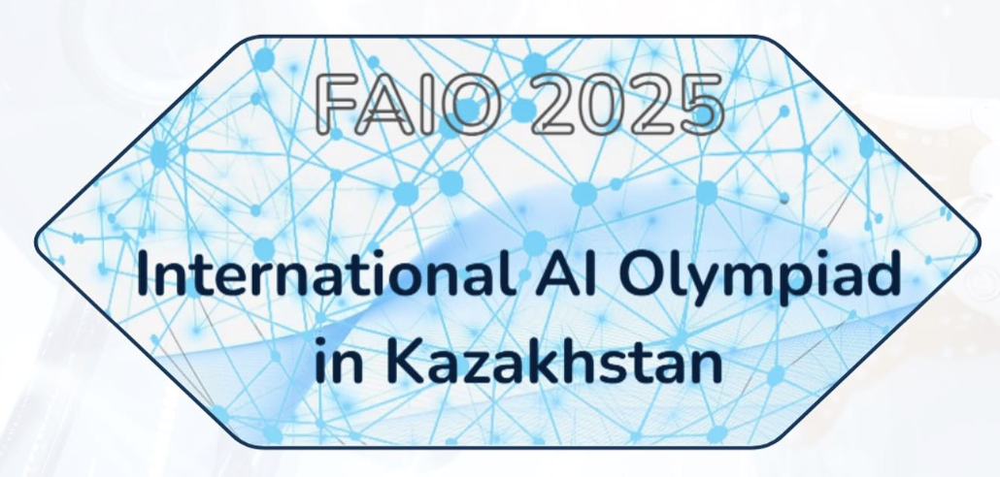

<!-- DOCTOC SKIP -->

<h1 align="center">
  
   FAIO 2026
</h1>

  🎓 3-ші олимпиада — есептер мен шарттар English, Қазақша және Русский тілдерінде.

<a href="./README.md">English</a> · <b>Қазақша</b> · <a href="./README.ru.md">Русский</a>

  
  
  

---

## 📚 Кезеңдер

### 🧠 Іріктеу кезеңі

Онлайн іріктеу кезеңі — бес есеп, кеш жіберуге ашық.

- 📘 **Ашу:** [README.kz.md](./qualification/README.kz.md)

**Есептер:**
[A — Бағаны кім қойды?](./qualification/a-who-evaluated/kz.md) ·
[B — Жүретін Робот](./qualification/b-robot-walker/kz.md) ·
[C — Бейтаныс планетада қалып қою](./qualification/c-stranded/kz.md) ·
[D — Мәтінді кері нормалау](./qualification/d-inverse-text-normalization/kz.md) ·
[E — Қосындының үштен бірі](./qualification/e-third-of-sum/kz.md)

### 🏁 1-күн

Бейне, дыбыс, көпөлшемді векторлар және мәтін — құрылым табу керек төрт сигнал.

- 📘 **Ашу:** [README.kz.md](./day1/README.kz.md)

**Есептер:**
[A — Жұмбақ атыс аттракционы](./day1/a-shooting-ride/kz.md) ·
[B — Пернетақтадағы әрекеттер](./day1/b-keyboard-activities/kz.md) ·
[C — Өлшемділікті төмендету](./day1/c-dimensionality-reduction/kz.md) ·
[D — Ақылды роутер](./day1/d-smart-router/kz.md)

### 🏁 2-күн

Дәрістер, тіл модельдері, бөлмедегі дауыстар және веб-іздеу.

- 📘 **Ашу:** [README.kz.md](./day2/README.kz.md)

**Есептер:**
[E — Араластырылған дәріс](./day2/e-lecture-shuffle/kz.md) ·
[F — Мұны кім жазды?](./day2/f-who-wrote-this/kz.md) ·
[G — Келу бағыты](./day2/g-direction-of-arrival/kz.md) ·
[H — Іздеу жүйесі](./day2/h-search-engine/kz.md)

---

## 📝 Қайта шешу және кеш жіберу

Он үш есептің бәрі **[contest.faio.kz](https://contest.faio.kz)** сайтында ашық — іріктеу кезеңі кеш жіберуге, ал екі жарыс күні қайта шешуге. Жүйеге кіріп, FAIO 2026 жарысын ашыңыз да, өз қарқыныңызбен жіберіңіз. 1 және 2-күннің әр шартында деректер жинағына тікелей сілтеме бар; оларды жүктеуге аккаунт қажет емес.

---

## Басқа жылдар

- [FAIO 2025](https://github.com/faio-official/faio-2025)
- [FAIO 2024](https://github.com/faio-official/faio-2024)
- [All FAIO repositories](https://github.com/faio-official)

---

## 👥 Credits
### Organizers | Jury | Authors

  
  
  
  
  
  
  
  
  

---

  Бұл — <a href="https://github.com/faio-official">FAIO</a> · <a href="./LICENSE">Apache-2.0</a>

