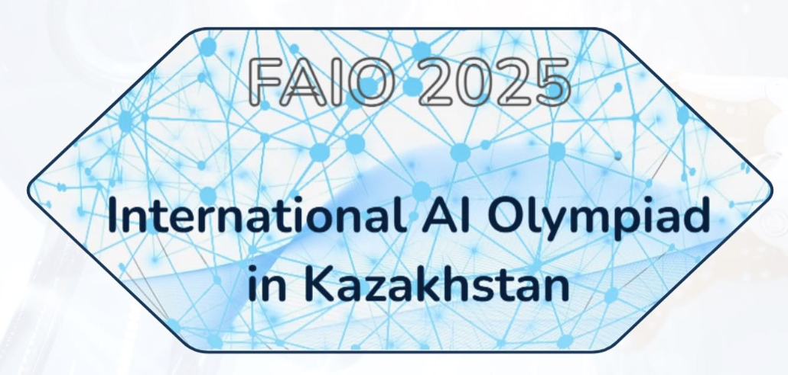

<!-- DOCTOC SKIP -->

<h1 align="center">
  
   FAIO 2026
</h1>

  🎓 3rd edition — tasks and statements in English, Қазақша and Русский.

<b>English</b> · <a href="./README.kz.md">Қазақша</a> · <a href="./README.ru.md">Русский</a>

  
  
  

---

## 📚 Rounds

### 🧠 Qualification Round

The online selection stage — five problems, open for late submission.

- 📘 **Open:** [README.md](./qualification/README.md)

**Problems:**
[A — Who evaluated it?](./qualification/a-who-evaluated/en.md) ·
[B — Robot Walker](./qualification/b-robot-walker/en.md) ·
[C — Stranded on an Unknown Planet](./qualification/c-stranded/en.md) ·
[D — Inverse Text Normalization](./qualification/d-inverse-text-normalization/en.md) ·
[E — Third of the Sum](./qualification/e-third-of-sum/en.md)

### 🏁 Day 1

Video, audio, high-dimensional vectors and text — four signals to pull structure out of.

- 📘 **Open:** [README.md](./day1/README.md)

**Problems:**
[A — The Mysterious Shooting Ride](./day1/a-shooting-ride/en.md) ·
[B — Keyboard Activities](./day1/b-keyboard-activities/en.md) ·
[C — Dimensionality Reduction](./day1/c-dimensionality-reduction/en.md) ·
[D — Smart Router](./day1/d-smart-router/en.md)

### 🏁 Day 2

Lectures, language models, voices in a room and web search.

- 📘 **Open:** [README.md](./day2/README.md)

**Problems:**
[E — Lecture Shuffle](./day2/e-lecture-shuffle/en.md) ·
[F — Who Wrote This?](./day2/f-who-wrote-this/en.md) ·
[G — Direction of Arrival](./day2/g-direction-of-arrival/en.md) ·
[H — Search Engine](./day2/h-search-engine/en.md)

---

## 📝 Upsolving and late submission

All thirteen problems stay open on **[contest.faio.kz](https://contest.faio.kz)** — the qualification round for late submission, and both contest days for upsolving. Sign in, open the FAIO 2026 contest and submit at your own pace. Each day-1 and day-2 statement links its dataset directly; those downloads need no account.

---

## Other years

- [FAIO 2025](https://github.com/faio-official/faio-2025)
- [FAIO 2024](https://github.com/faio-official/faio-2024)
- [All FAIO repositories](https://github.com/faio-official)

---

## 👥 Credits
### Organizers | Jury | Authors

  
  
  
  
  
  
  
  
  

---

  Part of <a href="https://github.com/faio-official">FAIO</a> · <a href="./LICENSE">Apache-2.0</a>

