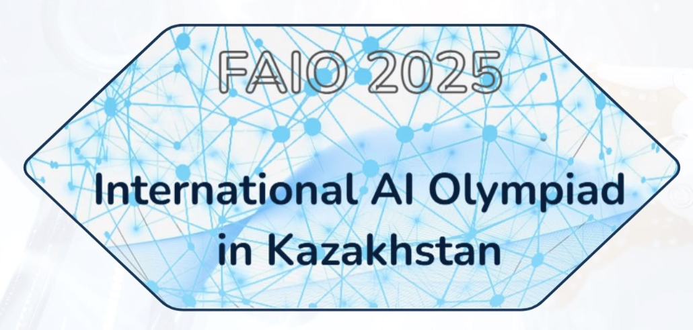

<!-- DOCTOC SKIP -->

<h1 align="center">
  
   FAIO 2026
</h1>

  🎓 3-я олимпиада — задачи и условия на English, Қазақша и Русский.

<a href="./README.md">English</a> · <a href="./README.kz.md">Қазақша</a> · <b>Русский</b>

  
  
  

---

## 📚 Туры

### 🧠 Отборочный тур

Онлайн-отборочный этап — пять задач, открыт для позднего сабмита.

- 📘 **Открыть:** [README.ru.md](./qualification/README.ru.md)

**Задачи:**
[A — Кто дал оценку?](./qualification/a-who-evaluated/ru.md) ·
[B — Шагающий Робот](./qualification/b-robot-walker/ru.md) ·
[C — Затерянные на неизведанной планете](./qualification/c-stranded/ru.md) ·
[D — Обратная нормализация текста](./qualification/d-inverse-text-normalization/ru.md) ·
[E — Треть суммы](./qualification/e-third-of-sum/ru.md)

### 🏁 День 1

Видео, звук, многомерные векторы и текст — четыре сигнала, из которых нужно извлечь структуру.

- 📘 **Открыть:** [README.ru.md](./day1/README.ru.md)

**Задачи:**
[A — Таинственный тир](./day1/a-shooting-ride/ru.md) ·
[B — Печать на клавиатуре](./day1/b-keyboard-activities/ru.md) ·
[C — Уменьшение размерности](./day1/c-dimensionality-reduction/ru.md) ·
[D — Умный роутер](./day1/d-smart-router/ru.md)

### 🏁 День 2

Лекции, языковые модели, голоса в комнате и веб-поиск.

- 📘 **Открыть:** [README.ru.md](./day2/README.ru.md)

**Задачи:**
[E — Лекция вперемешку](./day2/e-lecture-shuffle/ru.md) ·
[F — Кто это написал?](./day2/f-who-wrote-this/ru.md) ·
[G — Направление прибытия](./day2/g-direction-of-arrival/ru.md) ·
[H — Поисковый движок](./day2/h-search-engine/ru.md)

---

## 📝 Дорешивание и поздний сабмит

Все тринадцать задач открыты на **[contest.faio.kz](https://contest.faio.kz)** — отборочный тур для позднего сабмита, оба дня олимпиады для дорешивания. Войдите, откройте контест FAIO 2026 и отправляйте решения в своём темпе. В условиях дня 1 и дня 2 есть прямая ссылка на данные; для скачивания аккаунт не нужен.

---

## Другие годы

- [FAIO 2025](https://github.com/faio-official/faio-2025)
- [FAIO 2024](https://github.com/faio-official/faio-2024)
- [All FAIO repositories](https://github.com/faio-official)

---

## 👥 Credits
### Organizers | Jury | Authors

  
  
  
  
  
  
  
  
  

---

  Часть <a href="https://github.com/faio-official">FAIO</a> · <a href="./LICENSE">Apache-2.0</a>

