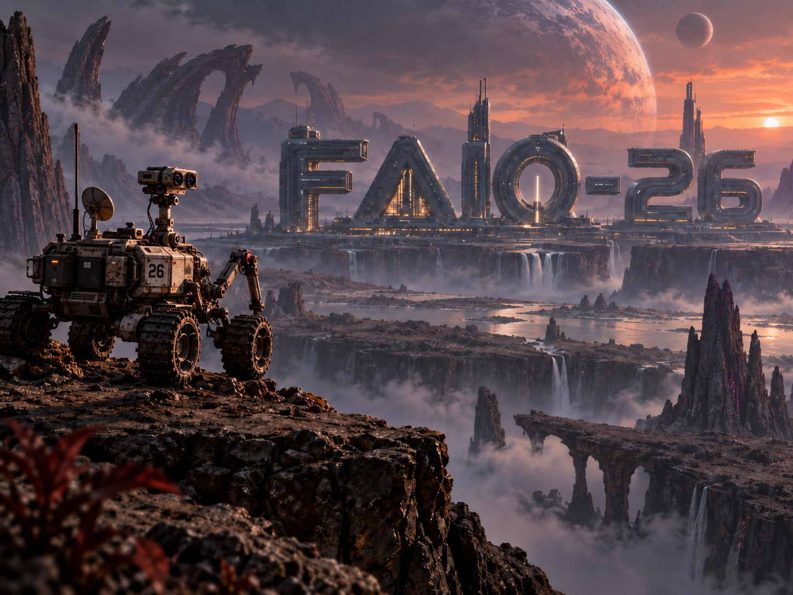

The robotic rover of your team has just been deployed to explore the surface of a planet called FAIO-26. Suddenly, a minor disaster strikes! Its wheels sink into a patch of soft, shifting dust, and its internal step-counter (wheel odometry) starts giving completely wrong distances and angles. The rover is effectively blind to how it's moving.

Luckily, its cameras are still working perfectly.

At one moment, the rover snaps a picture of the rocky landscape (Image A). It then slowly rolls and turns to get a better look, snapping a second picture (Image B). Your mission is to figure out exactly how far and in what direction the rover moved between these two snapshots, using *only* the pictures.

This is a simplified version of **visual odometry**: a real-world trick used by actual Mars rovers, self-driving cars, drones, and VR headsets to figure out where they are just by looking around.

## The Task

For every pair of pictures, you need to predict the rover's new "pose" (its exact location and the direction it's facing) in Image B, compared to where it was in Image A.

We describe this pose using two simple concepts:

1. Translation (Movement): (tx, ty, tz) — How far the rover moved left/right, up/down, and forward/backward.
2. Rotation (Turning): (qw, qx, qy, qz) — How much the rover tilted and turned.

### The Coordinate System (How we measure movement)

Imagine you are looking straight through the rover's camera lens when it takes Image A.

- +X points to the right side of the picture.
- +Y points down to the bottom of the picture.
- +Z points straight forward , out of the lens and into the scene.

Because of this setup, `(tx, ty, tz)` tells you exactly where the camera ended up for Image B, measured from its original spot in Image A. For example, if `tz` is a positive number, it means the rover moved further away into the scene. If `tx` is positive, it moved to the right.

### Understanding Rotation (Quaternions)

Instead of using standard angles (like pitch, yaw, and roll), which can get tangled up and glitch out when a robot looks straight up or down (a real robotics problem called "gimbal lock"), engineers use a clever 4-part code called a **quaternion**.

A quaternion is written as `(qw, qx, qy, qz)`. Here is the easiest way to think about it:

- `qw` relates to how much of a turn is happening.
- `qx`, `qy`, and `qz` work together to point to the direction or 3D axis of that turn.

You **do not** need to know the complex algebra behind it or calculate it by hand! BUT, If you want to see how it actually works under the hood, here are some great resources:

- For the code: Check out the SciPy Rotation documentation . It shows exactly how to use quaternions in Python without doing the math yourself.
- For the full mathematical theory: The Wikipedia article on Quaternions is a great deep dive into the algebra and history.

In your code, you can simply use standard programming libraries (like Python’s `scipy` or `numpy`) to handle the heavy math for you. For this competition, you may treat it as a reliable 4-number password that perfectly describes any 3D position.

*Two quick, reassuring notes:*

1. A quaternion and its exact opposite (flipping all the plus and minus signs) actually describe the exact same physical turn. Our grading system knows this and handles it automatically, so don't worry about it.
2. Your predicted numbers don't have to be perfectly balanced (normalized); the grader will automatically fix them before checking your answer.

## The Data

Each mission log contains two color pictures of the same static, unmoving landscape:

- image_a — The first camera view.
- image_b — The second camera view after the rover moved.

**Training Data:** You are given a "training set" where we tell you the exact correct answers (the real poses) so you can build and test your prediction model. **Test Data:** You are given a "test set" with only the pictures. You have to predict the poses yourself.

*Camera details:* The rover's camera might change its "zoom" (focal length) or center point slightly between different missions. We won't give you the exact camera specs, but both pictures in the same pair will always use the exact same camera settings. *Scale:* The planet uses a standard metric scale, so all distances are measured in **meters**.

### Training file

`train/labels.csv` contains the answers for your practice runs:

```
id,image_a,image_b,tx,ty,tz,qw,qx,qy,qz
```

Example:

```
7fa2c91e8ad01234,images/7fa2c91e8ad01234_a.jpg,images/7fa2c91e8ad01234_b.jpg,0.31,-0.04,0.82,0.992,0.015,-0.081,0.094
```

### Test file

`test/pairs.csv` contains the picture pairs you need to solve:

```
id,image_a,image_b
```

### Where to download the data?

[Train and Test data](https://drive.google.com/drive/folders/1R0Kdub2IIG0RPdoemGt9StcXYGXRVNOd?usp=drive_link)

[Sample Submission CSV file](https://drive.google.com/drive/folders/1R0Kdub2IIG0RPdoemGt9StcXYGXRVNOd?usp=drive_link)

## Output

Submit a CSV file with exactly one row for every test picture pair:

```
id,tx,ty,tz,qw,qx,qy,qz
```

The order of the rows doesn't matter, but every test `id` must appear exactly once. All seven predicted numbers must be real, finite numbers (no "infinity" or "NaN" errors).

## Scoring

For each pair of pictures, the grader checks two things:

1. **Translation Error (Distance):** The straight-line distance (in meters) between where you *predicted* the rover ended up, and where it *actually* ended up. $$e_t = \sqrt{(\hat{t}_x - t_x)^2 + (\hat{t}_y - t_y)^2 + (\hat{t}_z - t_z)^2}$$
2. **Rotation Error (Angle):** The difference in degrees between the direction you *predicted* it was facing, and the *true* direction. $$e_R = 2 \arccos \left( \left| \langle \hat{q}, q \rangle \right| \right)$$

You earn points based on how close you are. There are four levels of accuracy. To pass a level, **both** your distance AND angle errors must be under the limit:

| Level | Translation Error (Distance) | Rotation Error (Angle) | Points |
| --- | --- | --- | --- |
| **Excellent** | ≤ 0.10 meters | ≤ 2° | 25 |
| **Good** | ≤ 0.25 meters | ≤ 5° | 25 |
| **Fair** | ≤ 0.50 meters | ≤ 10° | 25 |
| **Coarse** | ≤ 1.00 meters | ≤ 20° | 25 |

Each level you pass adds 25 points to that specific picture pair's score. Your final contest score is the average of all your picture pair scores, out of 100.

*Example:* If your prediction is accurate enough for the "Fair" and "Coarse" levels, but not quite good enough for "Good", that specific pair gets 50 points.

## Final Notes

The landscapes aren't moving, but the rover's viewpoint might change a lot! Some picture pairs will look very similar, while others will look completely different because the rover turned a sharp corner or moved behind an object.

You may use any information available in the provided training and test data, as long as you follow the competition rules. Good luck, and happy exploring!
