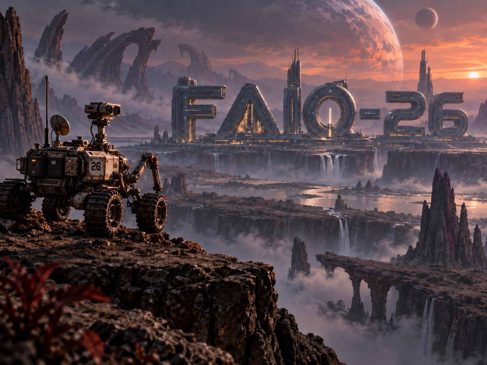

Сіздің командаңыздың робот-ровері FAIO-26 деп аталатын планетаның бетін зерттеу үшін жаңа ғана қондырылды. Кенеттен шағын апат болды! Оның дөңгелектері жұмсақ, сусымалы шаңға батып, ішкі қадам санағышы (дөңгелек одометриясы) қашықтық пен бұрыштарды мүлдем қате көрсете бастады. Ровер өзінің қалай қозғалып жатқанын білмей, соқыр күйде қалды.

Бақытымызға орай, оның камералары әлі де мінсіз жұмыс істеп тұр.

Бір сәтте ровер тасты ландшафтты суретке түсіреді (A суреті). Содан соң ол жақсырақ көру үшін баяу домалап, бұрылып, екінші суретті түсіреді (B суреті). Сіздің міндетіңіз — *тек* осы суреттерді пайдаланып, ровердің екі сурет арасында қаншалықты алыс және қай бағытта қозғалғанын дәл анықтау.

Бұл — **визуалды одометрияның** жеңілдетілген нұсқасы: нағыз Марс роверлері, өздігінен жүретін көліктер, дрондар және VR гарнитуралары айналаға қарап, өздерінің қайда екенін анықтау үшін қолданатын шынайы әдіс.

## Тапсырма

Әрбір сурет жұбы үшін сіз ровердің A суретіндегі орнымен салыстырғанда, B суретіндегі жаңа «позасын» (оның нақты орналасуы мен қарап тұрған бағытын) болжауыңыз керек.

Біз бұл позаны екі қарапайым ұғым арқылы сипаттаймыз:

1. Жылжу (Қозғалыс): (tx, ty, tz) — ровердің солға/оңға, жоғары/төмен және алға/артқа қаншалықты жылжығаны.
2. Айналу (Бұрылу): (qw, qx, qy, qz) — ровердің қаншалықты еңкейгені және бұрылғаны.

### Координаталар жүйесі (жылжуды қалай өлшейміз)

Ровер A суретін түсірген кезде оның камера объективі арқылы тіке қарап тұрсыз деп елестетіңіз.

- +X суреттің оң жағына бағытталған.
- +Y суреттің төменгі жағына бағытталған.
- +Z объективтен тіке алға , көріністің ішіне қарай бағытталған.

Осы орналасуға байланысты `(tx, ty, tz)` камераның B суреті үшін қай жерде аяқталғанын, оның A суретіндегі бастапқы нүктесінен бастап өлшеп, дәл көрсетеді. Мысалы, егер `tz` оң сан болса, бұл ровердің көріністің ішіне қарай әрі жылжығанын білдіреді. Егер `tx` оң болса, ол оңға жылжыған.

### Айналуды түсіну (Кватерниондар)

Инженерлер стандартты бұрыштарды (бойлық еңкею, бағыттық бұрылу, бүйірлік еңкею) пайдаланудың орнына (робот тіке жоғары немесе төмен қарағанда шатасып, істен шығуы мүмкін, бұл «кардан құлыпы» деп аталатын нақты робототехника мәселесі), **кватернион** деп аталатын 4 бөліктен тұратын тапқыр кодты қолданады.

Кватернион `(qw, qx, qy, qz)` түрінде жазылады. Оны түсінудің ең оңай жолы мынау:

- `qw` бұрылудың қаншалықты үлкен екеніне қатысты.
- `qx`, `qy` және `qz` бірігіп, сол бұрылудың бағытын немесе 3D осін көрсетеді.

Сізге оның артындағы күрделі алгебраны білудің немесе оны қолмен есептеудің **қажеті жоқ**! БІРАҚ, егер оның іс жүзінде қалай жұмыс істейтінін көргіңіз келсе, міне, бірнеше тамаша ресурстар:

- Код үшін: SciPy Rotation құжаттамасын қараңыз. Онда Python-да кватерниондарды математикалық есептеулерсіз қалай қолдану керектігі нақты көрсетілген.
- Толық математикалық теория үшін: Кватерниондар туралы Wikipedia мақаласы алгебра мен тарихқа терең үңілуге мүмкіндік береді.

Өз кодыңызда сіз күрделі математиканы орындау үшін стандартты бағдарламалау кітапханаларын (мысалы, Python-ның `scipy` немесе `numpy`) пайдалана аласыз. Бұл жарыс үшін сіз оны кез келген 3D позицияны мінсіз сипаттайтын сенімді 4 сандық құпия сөз ретінде қарастыра аласыз.

*Екі қысқа ескерту:*

1. Кватернион және оның дәл қарама-қарсысы (барлық плюс және минус таңбаларын ауыстыру) шын мәнінде бірдей физикалық бұрылысты сипаттайды. Біздің бағалау жүйеміз мұны біледі және автоматты түрде ескереді, сондықтан бұл туралы алаңдамаңыз.
2. Сіздің болжаған сандарыңыз мінсіз теңдестірілген (нормаланған) болуы шарт емес; бағалаушы жауабыңызды тексермес бұрын оларды автоматты түрде түзетеді.

## Деректер

Әрбір миссия журналында бірдей статикалық, қозғалмайтын ландшафттың екі түрлі-түсті суреті бар:

- image_a — бірінші камера көрінісі.
- image_b — ровер қозғалғаннан кейінгі екінші камера көрінісі.

**Оқыту деректері:** сізге болжау моделіңізді құрып, сынау үшін нақты дұрыс жауаптары (шынайы позалары) бар «оқыту жиынтығы» беріледі. **Тест деректері:** сізге тек суреттері бар «тест жиынтығы» беріледі. Позаларды өзіңіз болжауыңыз керек.

*Камера туралы мәліметтер:* ровер камерасының «зумы» (фокус қашықтығы) немесе орталық нүктесі әртүрлі миссиялар арасында сәл өзгеруі мүмкін. Біз сізге нақты камера сипаттамаларын бермейміз, бірақ бір жұптағы екі сурет те әрқашан бірдей камера параметрлерін қолданады. *Масштаб:* планета стандартты метрикалық шкаланы пайдаланады, сондықтан барлық қашықтықтар **метрмен** өлшенеді.

### Оқыту файлы

`train/labels.csv` файлында сіздің жаттығуларыңызға арналған жауаптар бар:

```
id,image_a,image_b,tx,ty,tz,qw,qx,qy,qz
```

Мысал:

```
7fa2c91e8ad01234,images/7fa2c91e8ad01234_a.jpg,images/7fa2c91e8ad01234_b.jpg,0.31,-0.04,0.82,0.992,0.015,-0.081,0.094
```

### Тест файлы

`test/pairs.csv` файлында сіз шешуіңіз керек сурет жұптары бар:

```
id,image_a,image_b
```

### Деректерді қайдан жүктеуге болады?

[Оқыту және тест деректері](https://drive.google.com/drive/folders/1R0Kdub2IIG0RPdoemGt9StcXYGXRVNOd?usp=drive_link)

[Тапсыруға арналған үлгі CSV файлы](https://drive.google.com/drive/folders/1R0Kdub2IIG0RPdoemGt9StcXYGXRVNOd?usp=drive_link)

## Шығыс деректері

Әрбір тест сурет жұбы үшін дәл бір жолы бар CSV файлын тапсырыңыз:

```
id,tx,ty,tz,qw,qx,qy,qz
```

Жолдардың реті маңызды емес, бірақ әрбір тест `id` дәл бір рет кездесуі керек. Барлық жеті болжанған сан нақты, шекті сандар болуы керек («шексіздік» немесе «NaN» қателері болмауы тиіс).

## Бағалау

Әрбір сурет жұбы үшін бағалаушы екі нәрсені тексереді:

1. **Жылжу қателігі (Қашықтық):** сіз *болжаған* ровердің соңғы орны мен оның *нақты* орны арасындағы түзу сызықты қашықтық (метрмен). $$e_t = \sqrt{(\hat{t}_x - t_x)^2 + (\hat{t}_y - t_y)^2 + (\hat{t}_z - t_z)^2}$$
2. **Айналу қателігі (Бұрыш):** сіз *болжаған* бағыт пен *шын* бағыт арасындағы айырмашылық (градуспен). $$e_R = 2 \arccos \left( \left| \langle \hat{q}, q \rangle \right| \right)$$

Сіз жақындығыңызға байланысты ұпай жинайсыз. Дәлдіктің төрт деңгейі бар. Бір деңгейден өту үшін қашықтық **ЖӘНЕ** бұрыш қателіктеріңіз шектен аспауы керек:

| Деңгей | Жылжу қателігі (Қашықтық) | Айналу қателігі (Бұрыш) | Ұпай |
| --- | --- | --- | --- |
| **Excellent** (Өте жақсы) | ≤ 0.10 метр | ≤ 2° | 25 |
| **Good** (Жақсы) | ≤ 0.25 метр | ≤ 5° | 25 |
| **Fair** (Қанағаттанарлық) | ≤ 0.50 метр | ≤ 10° | 25 |
| **Coarse** (Шамалас) | ≤ 1.00 метр | ≤ 20° | 25 |

Сіз өткен әрбір деңгей сол сурет жұбының ұпайына 25 ұпай қосады. Сіздің жарыстағы соңғы ұпайыңыз — барлық сурет жұптары ұпайларының орташа мәні (100 ұпайдан).

*Мысал:* егер сіздің болжамыңыз «Fair» және «Coarse» деңгейлеріне жеткілікті дәл болса, бірақ «Good» деңгейіне сәл жетпесе, сол нақты жұп 50 ұпай алады.

## Қорытынды ескертпелер

Ландшафттар қозғалмайды, бірақ ровердің көру нүктесі қатты өзгеруі мүмкін! Кейбір сурет жұптары өте ұқсас болып көрінеді, ал басқалары ровердің кенет бұрылуына немесе нысанның артына өтуіне байланысты мүлдем басқаша көрінуі мүмкін.

Сіз жарыс ережелерін сақтай отырып, берілген оқыту және тест деректеріндегі кез келген ақпаратты пайдалана аласыз. Сәттілік және зерттеулеріңіз қызықты өтсін!
