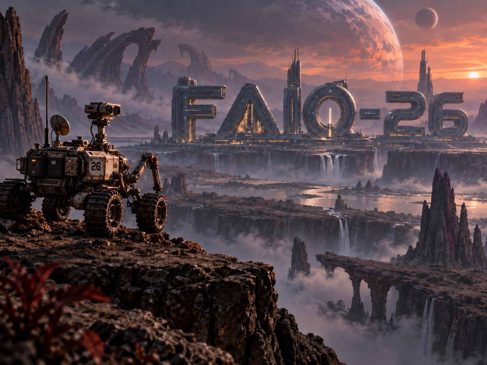

Роботизированный ровер вашей команды только что был отправлен исследовать поверхность планеты под названием FAIO-26. И вдруг происходит небольшая катастрофа! Его колёса проваливаются в участок мягкой, подвижной пыли, и внутренний счётчик перемещения (колёсная одометрия) начинает выдавать совершенно неверные расстояния и углы. Фактически ровер больше не понимает, как именно он движется.

К счастью, его камеры по-прежнему работают идеально.

В какой-то момент ровер делает снимок каменистого ландшафта (Изображение A). Затем он медленно перемещается и поворачивается, чтобы лучше осмотреться, и делает второй снимок (Изображение B). Ваша задача — определить, насколько далеко и в каком направлении переместился ровер между этими двумя снимками, используя *только* изображения.

Это упрощённая версия **визуальной одометрии** — реального метода, который используется настоящими марсоходами, беспилотными автомобилями, дронами и VR-гарнитурами, чтобы определять своё положение, ориентируясь только на окружающую сцену.

## Задача

Для каждой пары изображений необходимо предсказать новую «позу» ровера (его точное положение и направление, в котором он ориентирован) на Изображении B относительно его положения на Изображении A.

Мы описываем эту позу с помощью двух простых понятий:

1. Трансляция (перемещение): (tx, ty, tz) — насколько далеко ровер переместился влево/вправо, вверх/вниз и вперёд/назад.
2. Вращение (поворот): (qw, qx, qy, qz) — насколько сильно ровер наклонился и повернулся.

### Система координат (как мы измеряем перемещение)

Представьте, что вы смотрите прямо через объектив камеры ровера в момент, когда делается Изображение A.

- +X направлена вправо по изображению.
- +Y направлена вниз , к нижней части изображения.
- +Z направлена прямо вперёд , от объектива вглубь сцены.

Благодаря такой системе координат `(tx, ty, tz)` точно указывает, где оказалась камера при съёмке Изображения B относительно её исходного положения при съёмке Изображения A. Например, если `tz` — положительное число, это означает, что ровер переместился вперёд, дальше вглубь сцены. Если `tx` положителен, значит, он переместился вправо.

### Понимание вращения (кватернионы)

Вместо обычных углов, которые могут приводить к проблемам и неоднозначностям, когда робот смотрит строго вверх или вниз (в робототехнике эта реальная проблема называется «складыванием рамок», или *gimbal lock*), инженеры используют удобное четырёхкомпонентное представление, называемое **кватернионом**.

Кватернион записывается как `(qw, qx, qy, qz)`. Проще всего понимать его следующим образом:

- `qw` связан с тем, насколько большой выполняется поворот.
- `qx`, `qy` и `qz` вместе задают направление , или трёхмерную ось, вокруг которой происходит этот поворот.

Вам **не нужно** знать сложную алгебру, лежащую в основе кватернионов, или вычислять их вручную! НО если вы хотите разобраться, как всё это работает «под капотом», вот несколько отличных ресурсов:

- Для программирования: ознакомьтесь с документацией SciPy по Rotation . Там подробно показано, как использовать кватернионы в Python, не выполняя всю математику самостоятельно.
- Для полной математической теории: статья Википедии о кватернионах отлично подходит для глубокого изучения их алгебры и истории.

В своём коде вы можете просто использовать стандартные программные библиотеки (например, Python-библиотеки `scipy` или `numpy`), которые выполнят всю сложную математику за вас. В рамках этого соревнования можно считать кватернион надёжным «паролем» из четырёх чисел, который точно описывает любое положение в трёхмерном пространстве.

*Два коротких уточнения:*

1. Кватернион и полностью противоположный ему кватернион (то есть тот, у которого изменены знаки всех компонентов) на самом деле описывают один и тот же физический поворот. Наша система оценки это учитывает автоматически, поэтому об этом можно не беспокоиться.
2. Предсказанные вами числа не обязаны быть идеально нормализованы; система оценки автоматически нормализует их перед проверкой ответа.

## Данные

Каждый журнал миссии содержит два цветных изображения одного и того же статичного, неподвижного ландшафта:

- image_a — первый вид с камеры.
- image_b — второй вид с камеры после перемещения ровера.

**Обучающие данные:** вам предоставляется «обучающая выборка», в которой указаны точные правильные ответы (реальные позы), чтобы вы могли построить и протестировать свою модель предсказания.

**Тестовые данные:** вам предоставляется «тестовая выборка», содержащая только изображения. Позы необходимо предсказать самостоятельно.

*Параметры камеры:* камера ровера может немного менять свой «зум» (фокусное расстояние) или положение центральной точки между различными миссиями. Точные параметры камеры предоставляться не будут, однако оба изображения внутри одной пары всегда будут сняты с абсолютно одинаковыми настройками камеры.

*Масштаб:* на планете используется стандартная метрическая система, поэтому все расстояния измеряются в **метрах**.

### Обучающий файл

`train/labels.csv` содержит правильные ответы для ваших тренировочных примеров:

```
id,image_a,image_b,tx,ty,tz,qw,qx,qy,qz
```

Пример:

```
7fa2c91e8ad01234,images/7fa2c91e8ad01234_a.jpg,images/7fa2c91e8ad01234_b.jpg,0.31,-0.04,0.82,0.992,0.015,-0.081,0.094
```

### Тестовый файл

`test/pairs.csv` содержит пары изображений, для которых необходимо найти решение:

```
id,image_a,image_b
```

### Где скачать данные?

[Обучающие и тестовые данные](https://drive.google.com/drive/folders/1R0Kdub2IIG0RPdoemGt9StcXYGXRVNOd?usp=drive_link)

[Пример CSV-файла для отправки решения](https://drive.google.com/drive/folders/1R0Kdub2IIG0RPdoemGt9StcXYGXRVNOd?usp=drive_link)

## Формат результата

Необходимо отправить CSV-файл, содержащий ровно одну строку для каждой тестовой пары изображений:

```
id,tx,ty,tz,qw,qx,qy,qz
```

Порядок строк не имеет значения, однако каждый тестовый `id` должен встречаться ровно один раз. Все семь предсказанных чисел должны быть действительными и конечными числами (без значений `"infinity"` или ошибок `"NaN"`).

## Оценивание

Для каждой пары изображений система оценки проверяет два параметра:

1. **Ошибка трансляции (расстояние):** расстояние по прямой линии (в метрах) между положением, в котором ровер оказался согласно вашему *предсказанию*, и положением, в котором он оказался *на самом деле*. $$e_t = \sqrt{(\hat{t}_x - t_x)^2 + (\hat{t}_y - t_y)^2 + (\hat{t}_z - t_z)^2}$$
2. **Ошибка вращения (угол):** разница в градусах между направлением, в котором ровер ориентирован согласно вашему *предсказанию*, и его *истинной* ориентацией. $$e_R = 2 \arccos \left( \left| \langle \hat{q}, q \rangle \right| \right)$$

Вы получаете баллы в зависимости от точности предсказания. Существует четыре уровня точности. Чтобы пройти определённый уровень, **и ошибка расстояния, и ошибка угла** должны быть не больше установленного предела:

| Уровень | Ошибка трансляции (расстояние) | Ошибка вращения (угол) | Баллы |
| --- | --- | --- | --- |
| **Отлично (Excellent)** | ≤ 0,10 метра | ≤ 2° | 25 |
| **Хорошо (Good)** | ≤ 0,25 метра | ≤ 5° | 25 |
| **Удовлетворительно (Fair)** | ≤ 0,50 метра | ≤ 10° | 25 |
| **Грубо (Coarse)** | ≤ 1,00 метра | ≤ 20° | 25 |

Каждый пройденный уровень добавляет 25 баллов к результату именно этой пары изображений. Итоговый результат соревнования — это средний балл по всем парам изображений, максимум — 100 баллов.

*Пример:* если ваше предсказание достаточно точное, чтобы пройти уровни «Fair» и «Coarse», но недостаточно точное для уровня «Good», эта конкретная пара получит 50 баллов.

## Заключительные примечания

Ландшафт остаётся неподвижным, однако точка обзора ровера может меняться очень сильно! Некоторые пары изображений будут выглядеть почти одинаково, а другие могут выглядеть совершенно по-разному, например если ровер резко повернул за угол или переместился за какой-либо объект.

Вы можете использовать любую информацию, содержащуюся в предоставленных обучающих и тестовых данных, при условии соблюдения правил соревнования.

Удачи и приятных исследований!
